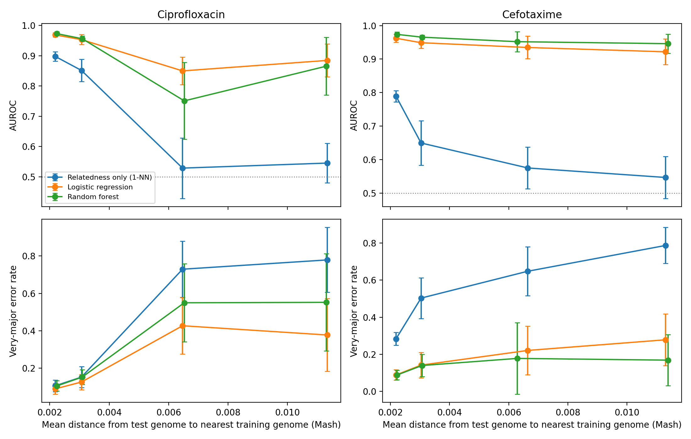

# Does random cross-validation inflate genome-based antibiotic-resistance prediction?

A leakage-aware benchmark on *Escherichia coli* (ciprofloxacin and cefotaxime), using public BV-BRC data.

> **Status:** pilot / benchmark study done as a short, single-person project. Not peer reviewed. See Limitations.

## Summary

- **Question.** Bacterial genomes are clonal, so near-identical relatives land in both train and test under random cross-validation. How much does that inflate reported performance, and do k-mer models still predict resistance on lineages they have not seen?
- **Leakage is real.** A baseline that uses *only* genomic relatedness (1-nearest-neighbour on Mash distance, no biology) reaches AUROC 0.90 (ciprofloxacin) and 0.79 (cefotaxime) under random 5-fold CV. When relatives within about 0.5% Mash divergence are held out, it falls to 0.53 and 0.58, close to chance.
- **Models keep signal, unevenly.** Under the same cluster-held-out splits, k-mer logistic regression and random forest keep AUROC 0.92 to 0.95 for cefotaxime. For ciprofloxacin they fall more (0.75 to 0.88), and very-major errors (resistant predicted susceptible) rise from about 0.10 to 0.4 to 0.55.
- **Biology check.** For cefotaxime, 63% of the k-mers that were stably resistance-associated across held-out-lineage folds (77 of 122) fall inside known resistance genes, versus 1.01% of all features. 66 are in the *bla*CTX-M family. For ciprofloxacin, 0 of 31 do, consistent with (but not proof of) point-mutation-driven resistance, since the reference holds acquired genes only.

## Data

- **Labels:** BV-BRC (formerly PATRIC) laboratory antimicrobial-susceptibility phenotypes, `PATRIC_genomes_AMR.txt`. *E. coli* genomes labelled Resistant or Susceptible; genomes with conflicting labels removed.
- **Genomes:** assemblies downloaded from the BV-BRC FTP (FTPS).
- **Sample:** 6,186 genomes carry labels for both drugs. A stratified sample of 1,200 over the four (cipro, cefotaxime) phenotype combinations was drawn to enrich resistant classes; 1,192 passed QC (length 4.5 to 5.8 Mb, at most 500 contigs).
- **Prevalence in the sample:** ciprofloxacin 46% resistant, cefotaxime 42% resistant (natural prevalence in the 6,186 was 22% and 16%). Absolute AUPRC is therefore not comparable with published values; the comparisons between split types are on identical data.
- **Reference genes:** NCBI AMRFinderPlus database, `AMR_CDS.fa` (9,866 coding sequences, acquired resistance genes).

## Methods

**Distances and clusters.** Mash (k = 21, sketch size 10,000) pairwise distances. Average-linkage clustering at 0.1%, 0.5% and 1% divergence (751, 240 and 98 clusters; largest cluster 2%, 19%, 21% of genomes). A 2% threshold was dropped because one cluster held 50% of genomes.

**Splits.**
- `random`: stratified 5-fold.
- `t0.001`, `t0.005`, `t0.01`: `StratifiedGroupKFold` (5 folds) with cluster IDs as groups, so no cluster spans train and test.
- Clusters use genome-genome distances only, never labels. Fold seeds 0 to 2.

**Features.** 21-mer presence/absence. A deterministic 1/32 hash-sample of canonical 21-mers per genome; features kept if present in 2% to 98% of genomes (493,810 features).

**Models.**
- Relatedness-only baseline: label of the nearest training genome by Mash distance.
- L2 logistic regression (C = 0.1).
- Random forest (200 trees).
- For both ML models, the top 20,000 features by chi-squared are selected **inside each training fold only**. Hyperparameters were fixed in advance (not tuned).

**Metrics.** AUROC, AUPRC, MCC, very-major error rate (resistant predicted susceptible, threshold 0.5), and mean distance from each test genome to its nearest training genome.

**Feature stability.** For each drug, using the `t0.005` split (seed 0), the 200 features with the largest positive logistic-regression coefficients were taken per fold. Features appearing in at least 4 of 5 folds were called "stable". Stable k-mers were looked up (both strands) in all 21-mers of the reference resistance genes.

## Results

Mean AUROC over folds and seeds (random forest: 1 seed).

| Drug | Split | Relatedness only | Logistic regression | Random forest |
|---|---|---|---|---|
| Cefotaxime | random | 0.789 | 0.962 | 0.974 |
| | t0.001 | 0.650 | 0.949 | 0.965 |
| | t0.005 | 0.575 | 0.935 | 0.952 |
| | t0.01 | 0.547 | 0.922 | 0.946 |
| Ciprofloxacin | random | 0.898 | 0.969 | 0.973 |
| | t0.001 | 0.851 | 0.953 | 0.956 |
| | t0.005 | 0.529 | 0.850 | 0.751 |
| | t0.01 | 0.545 | 0.884 | 0.866 |

Very-major error rate (models):

| Drug | Model | random | t0.001 | t0.005 | t0.01 |
|---|---|---|---|---|---|
| Cefotaxime | Logistic regression | 0.089 | 0.142 | 0.221 | 0.278 |
| | Random forest | 0.089 | 0.140 | 0.178 | 0.169 |
| Ciprofloxacin | Logistic regression | 0.089 | 0.125 | 0.427 | 0.377 |
| | Random forest | 0.104 | 0.152 | 0.550 | 0.552 |

Fold-level standard deviations are in `results/summary_table.csv`. They are large for ciprofloxacin at the harder splits, so differences between logistic regression and random forest there should not be interpreted.

**Feature analysis.**

| Drug | Stable k-mers | Inside reference AMR genes | Top family |
|---|---|---|---|
| Cefotaxime | 122 | 77 (63.1%; baseline 1.01%) | *bla*CTX-M (66 k-mers); *aac(6')-Ib* family (11 k-mers, shared among alleles) |
| Ciprofloxacin | 31 | 0 | none |

Many allele names share identical k-mers, so counts are per family, not per allele. The *aac(6')-Ib* hit is an aminoglycoside-resistance gene; a likely explanation is co-location with CTX-M genes on plasmids (linkage), which was not tested here.

## Limitations

- One species, two drugs, one data source. No external validation set.
- Sample was enriched for resistant genomes and subsampled from a larger pool, which may change how much near-relative leakage there is. Effect not quantified.
- Clusters are defined from Mash distance, not a core-genome phylogeny.
- The 1/32 k-mer sampling can miss individual point mutations, so the weaker ciprofloxacin results may partly reflect missing features rather than lineage effects alone. The *gyrA* / *parC* hypothesis was not tested directly.
- Hyperparameters were fixed, not tuned. Random forest used a single seed. Folds share training data, so no formal significance tests were run.
- The two drugs' labels are correlated across genomes (many genomes are resistant to both), which can blur attribution.
- Phenotype labels in BV-BRC come from mixed laboratory methods and breakpoints.
- Stable-feature ranking by coefficient is sensitive to correlated k-mers; a gene hit shows association, not causation.

## Future work

- Add a temporal or phylogeny-tree-based split and an external cohort (for example NCBI Pathogen Detection).
- Use full k-mers or called mutations (*gyrA*, *parC*) to test the point-mutation explanation for ciprofloxacin.
- Quantify the effect of sample density on the inflation gap.
- Add more species and drugs.

## Reproduce

Run in Google Colab (CPU runtime is enough), in this order:

1. `01_data_curation`: download labels, curate, stratified sample, download genomes, QC.
2. `02_distances_clusters`: Mash sketch, distance matrix, clusters.
3. `03_relatedness_baseline`: 1-nearest-neighbour baseline.
4. `04_kmer_features`: k-mer extraction and feature matrix.
5. `05_models`: logistic regression and random forest under all splits.
6. `06_figures_and_feature_analysis`: headline figure, stable k-mers, mapping to resistance genes.

Large intermediates (`genomes/`, `kmers/`, the feature matrix) are not in this repository; they are regenerated by steps 1 and 4. Small results (`results/*.csv`, `D.npy`, `clusters.csv`) are included.

## Files

- `results/`: per-fold metrics (`results_1nn_folds.csv`, `results_logreg.csv`, `results_rf.csv`), `summary_table.csv`, `stable_kmers_amr_map.csv`
- `figures/headline_figure.png`
- `data/`: `sample_qc.csv` (the 1,192 genomes and labels), `clusters.csv`, `D.npy`

## Data sources and licences

BV-BRC (https://www.bv-brc.org), NCBI AMRFinderPlus database (https://ftp.ncbi.nlm.nih.gov/pathogen/Antimicrobial_resistance/AMRFinderPlus/), Mash.
